**Format:** Scalable vector graphics (SVG)

**Master copies:** The `_Assets/SVGs/` folder in the Studio vault

**How they are managed:**

- **Live** - `_Assets/SVGs/`, one flat folder. Names never carry a version number and never change, so links never break. Nobody edits a live file directly.
- **Workshop** - `_Assets/SVGs/_in-process/`. To change a diagram, copy it here as `name-v1.svg` and iterate (`-v2`, `-v3`). Version numbers live only here.
- **Promote** - when it is ready, copy the final version over the live file, keeping the live name. Every page picks it up.
- **Archive** - before promoting, copy the old live file to `_Assets/SVGs/_archive/` as `name-pre-YYYY-MM-DD.svg`. Git also keeps the history of every live file.
- **With or without the logo** - a diagram that carries the PHI⑊PIN logo has two live files: `name.svg` without the logo, which documents use, and `name-logo.svg` with it.

## The PHI⑊PIN architecture

How PHI⑊PIN goes to business, from the people-first foundation (PHI) and identity (PIN), through elements and engagement, to domains, products, applications, services and the value customers see.

![[architecture-philpin.svg|560]]

File: `architecture-philpin.svg`

## The Business Equation

Every business is an equation: people, money and things go into the business, and value comes out. The picture shows where the weight has moved. Rust is the old world, bottom left: systems of record and producer efficient supply chains (PESC). Blue is the new, top right: systems of engagement and customer effective demand networks (CEDN), with the market now in charge. Market, Organisation, Production and Commerce sit around the core; the diagonal runs rust to blue. Drawn on the golden rectangle, to match the architecture. See [[Business Equation]].

<figure style="margin:0;">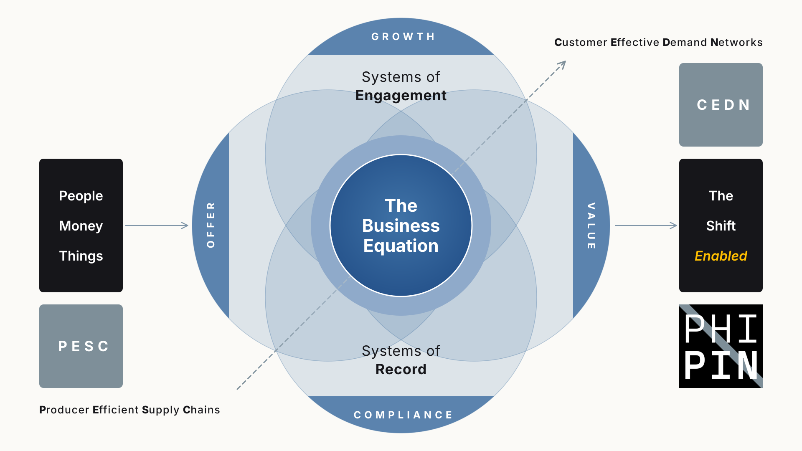<figcaption><strong>Now.</strong> <code>business-equation.svg</code></figcaption></figure>
<figure style="margin:0;"><figcaption><strong>Original</strong>, kept as a reference. <code>business-equation-original.svg</code></figcaption></figure>

Also: `business-equation-logo.svg`, the current picture with the logo.

## PESC and CEDN

PESC, how value gets made, mirrored by CEDN, who value is for: Producer and Customer, Efficient and Effective, Supply and Demand, Chain and Network. See [[PESC]] and [[CEDN]].

![[pesc-cedn-mirror.svg|560]]

File: `pesc-cedn-mirror.svg`

## The eight Domains

The eight Domains arranged around the individual and the organisation, each in its accent colour. See [[Eight Domains Map]] and [[Domains Index|the Domains]].

![[domains-eight.svg|560]]

File: `domains-eight.svg`

## Domains applied

The eight Domains as a wheel, with the deliverable types inside it and value at the centre. The interactive version is on philpin.com; here it appears as a still.

![[domains-applied.svg|560]]

File: `domains-applied.svg`

## Deliverable types

The deliverable types a Domain can take: Advisory, Consulting, Enablement, Injection, Licence and Product. See [[Deliverable Types]].

![[domains-deliverable-types.svg|560]]

File: `domains-deliverable-types.svg`

## The People First Framework

Purpose sets the direction, two frames hold everything, five flows keep five states true, and performance is what comes out. See [[People First Framework]].

![[framework-people-first.svg|560]]

File: `framework-people-first.svg`

## Stages of understanding

The six stages of [[DIKIWI]], drawn as static images. Interactive versions of the six are on philpin.com.

<figure style="margin:0;text-align:center;">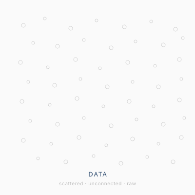<figcaption><strong>Data</strong> Scattered, unconnected, raw</figcaption></figure>
<figure style="margin:0;text-align:center;">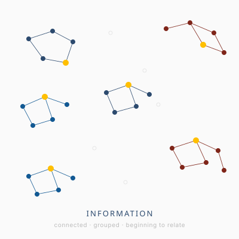<figcaption><strong>Information</strong> Connected, grouped, beginning to relate</figcaption></figure>
<figure style="margin:0;text-align:center;">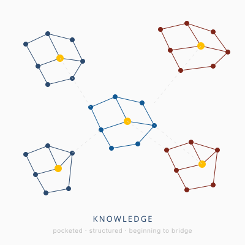<figcaption><strong>Knowledge</strong> Pocketed, structured, beginning to bridge</figcaption></figure>
<figure style="margin:0;text-align:center;">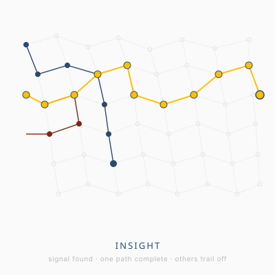<figcaption><strong>Insight</strong> Signal found, one path complete, others trailing off</figcaption></figure>
<figure style="margin:0;text-align:center;">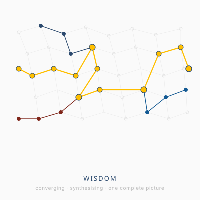<figcaption><strong>Wisdom</strong> Converging, synthesising, one complete picture</figcaption></figure>
<figure style="margin:0;text-align:center;">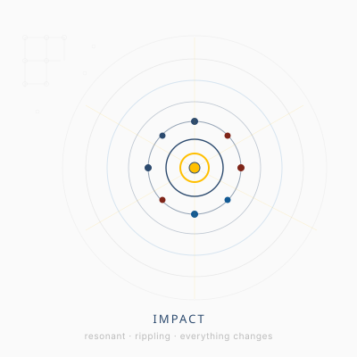<figcaption><strong>Impact</strong> Resonant, rippling, everything changes</figcaption></figure>

Files: `dikiwi-1-data.svg`, `dikiwi-2-information.svg`, `dikiwi-3-knowledge.svg`, `dikiwi-4-insight.svg`, `dikiwi-5-wisdom.svg`, `dikiwi-6-impact.svg`

## The Personal Dashboard

An individual lens that works across any app, drawing on Pulse, Community, Intelligence and Library modules, a shared database and third-party services.

![[domains-personal-dashboard.svg|560]]

File: `domains-personal-dashboard.svg`

**Across ecosystems.** One Personal Dashboard connecting to several ecosystems at once, each seen through the same individual lens.

![[domains-personal-integrated-dashboard.svg|560]]

File: `domains-personal-integrated-dashboard.svg`

## Identity

<figure style="margin:0;">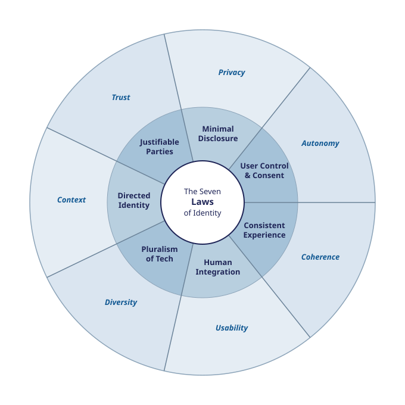<figcaption><strong>Cameron's Seven Laws of Identity.</strong> User control and consent, minimal disclosure, justifiable parties, directed identity, pluralism of technology, human integration and a consistent experience. <code>identity-cameron-seven-laws.svg</code></figcaption></figure>
<figure style="margin:0;">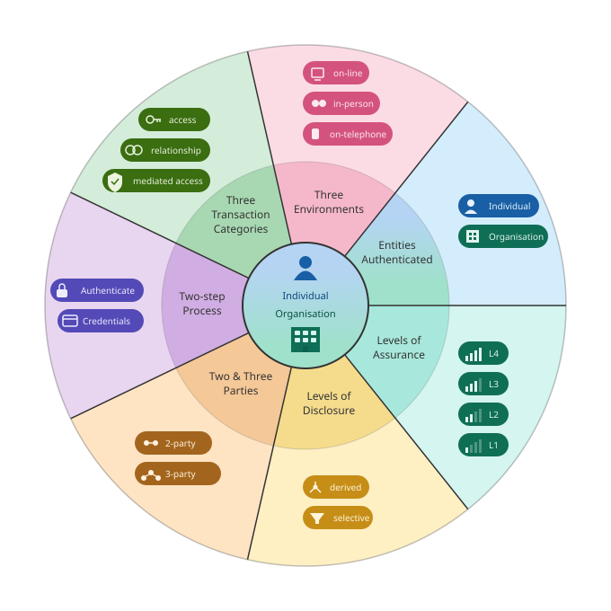<figcaption><strong>The seven dimensions of identity.</strong> Where it happens, what is being done, who is involved, who is proven, how they prove it, how much confidence and how much is shared. <code>identity-mayo-seven-dimensions.svg</code></figcaption></figure>

See [[Identity]].

## Software As A Sandwich

SAAS, a framework that sets scope of concern (personal, contained, scalable) against decision authority (vibe, tension, structure) to name nine software postures, from The Sketch to The Cathedral. Original idea by Andrew Mayfield; graphic inspired by the "define a sandwich" meme.

![[framework-software-as-a-sandwich.svg|560]]

File: `framework-software-as-a-sandwich.svg`

## The PHI⑊PIN logotype

The mark itself, in six formats built to one set of rules. See [[Style Guide]] for the rules and when to use each, and [[About The Logo]] for the story.

![[philpin-logo-wide.svg|560]]

**Wide.** One line. Headers, mastheads, footers. `philpin-logo-wide.svg`

<figure style="margin:0;">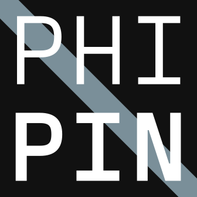<figcaption><strong>Square.</strong> App icons, favicons. <code>philpin-logo-square.svg</code></figcaption></figure>
<figure style="margin:0;">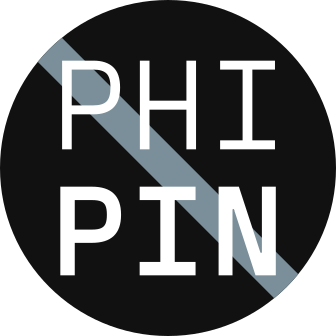<figcaption><strong>Circle.</strong> Avatars, round crops. <code>philpin-logo-circle.svg</code></figcaption></figure>
<figure style="margin:0;">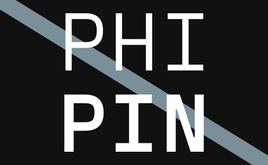<figcaption><strong>φ badge.</strong> Golden rectangle. Cards, slides, screens. <code>philpin-logo-phi.svg</code></figcaption></figure>

<figure style="margin:0;">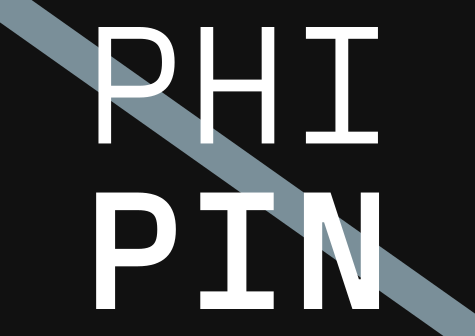<figcaption><strong>A-series.</strong> The A paper shape, landscape. <code>philpin-logo-a-series.svg</code></figcaption></figure>
<figure style="margin:0;">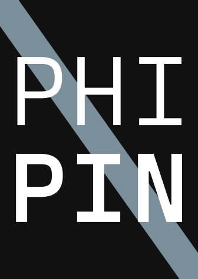<figcaption><strong>A-series portrait.</strong> Covers, posters. <code>philpin-logo-a-series-portrait.svg</code></figcaption></figure>

